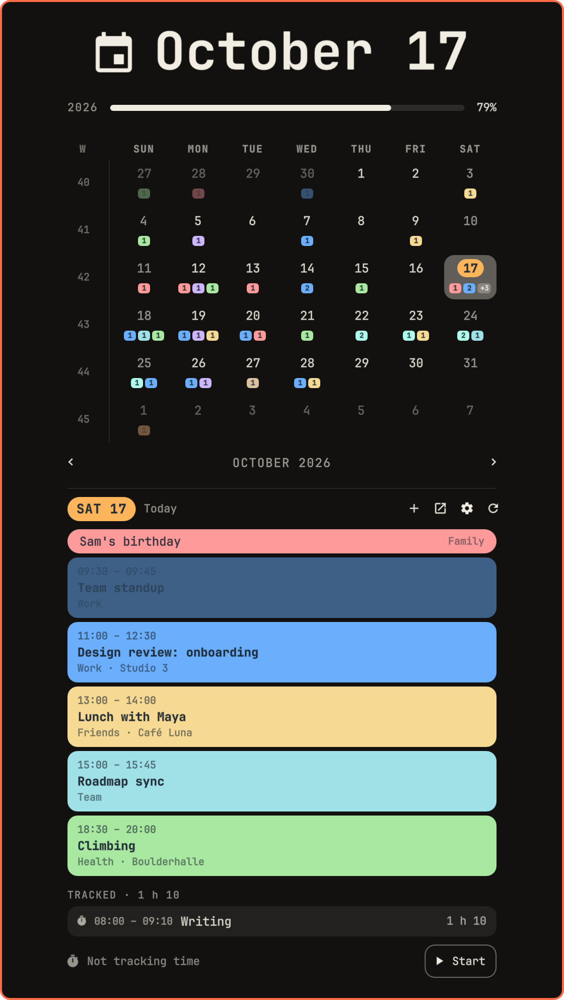
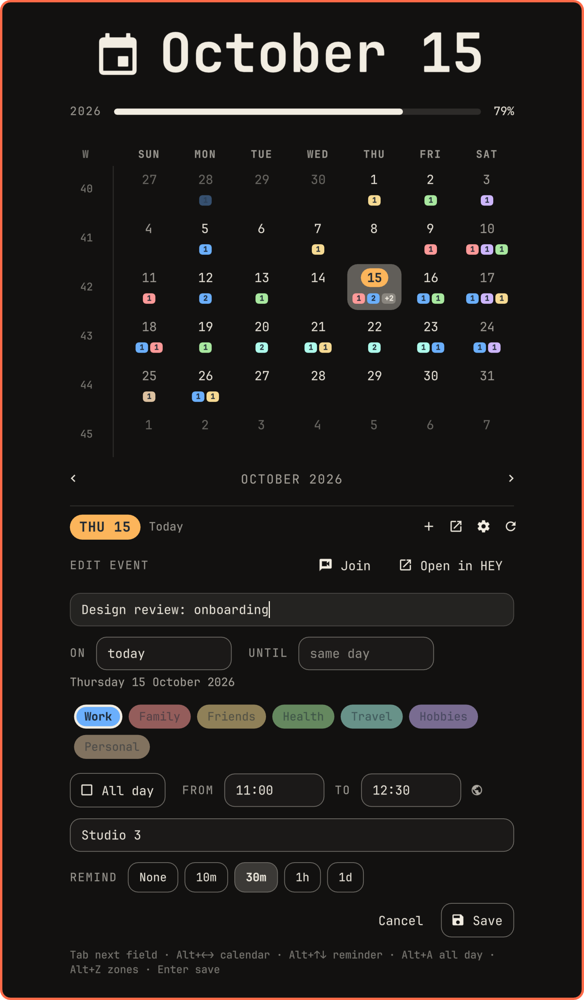
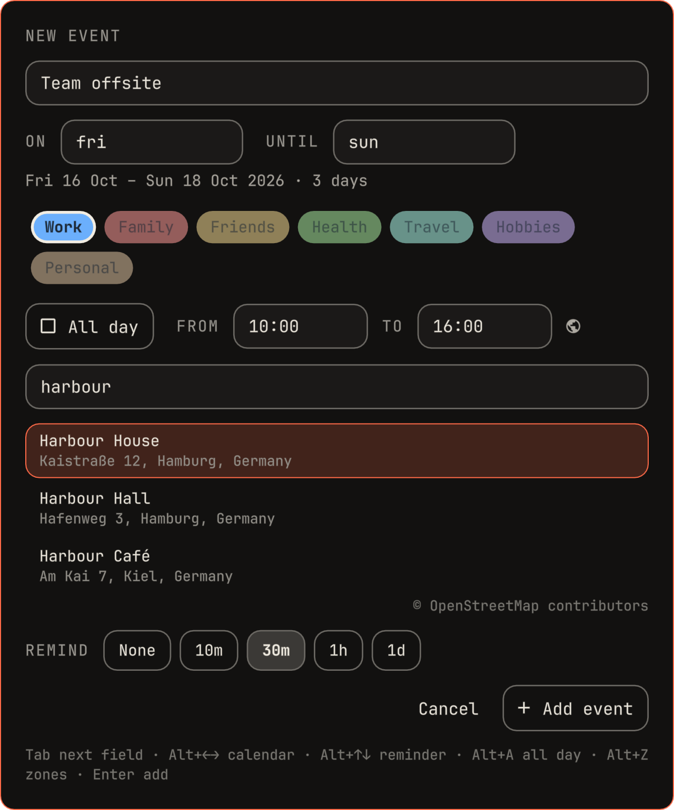
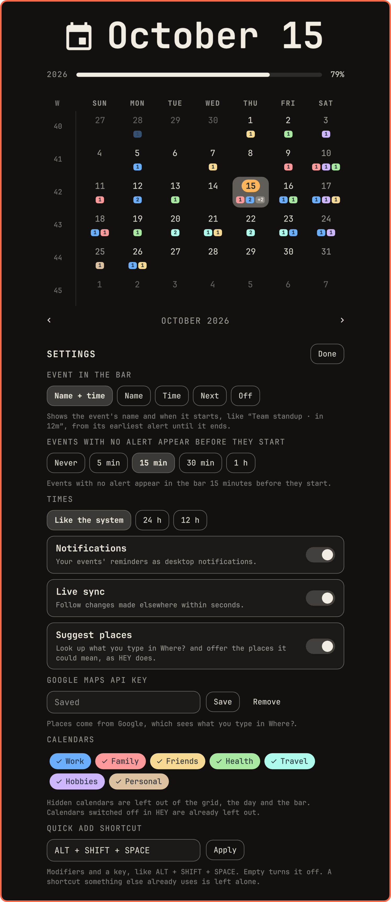
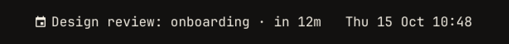

# OmaCal

Omarchy's stock clock and calendar, exactly as it ships, with your calendars
laid over it: [HEY](https://hey.com), Google Calendar, and any calendar
published as an `.ics` feed, side by side (see [Calendars](#calendars)).



- **Chips under every day.** One chip per calendar color, with the number of
  that day's events in it. A day with a Work meeting and a dinner shows a
  blue `1` and a red `1`. More than three colors collapse into `+N`. Hover a
  day for its events.
- **Click a day to see it.** The day view under the grid draws the day the
  way HEY does: all-day pills, then a pastel block per event with its time,
  calendar and location. The event under way is ringed and marked `NOW`.
  Clicking an event edits it; its join button (or `J`) opens the meeting.
- **New events.** `+`, `N`, or double-clicking a day opens a quick form:
  title, day, calendar, all-day or a time range, place, reminder. Days and
  times are typed loosely: `fri`, `tomorrow`, `next mon`, `3 oct` for the
  day, `9`, `930`, `9:30pm`, `21.30` for times. An event over several
  days gives its last one under **until**, read from the start (`sun` is
  the first Sunday from it, `+2` two days after it); its end time is on
  that day, and moving the start moves it along. Without one, an end before
  the start means the next morning. Times are this machine's local time. As in HEY's
  own form, the globe next to the times (or `Alt+Z`) shows a zone under
  each of them, as a city you can type over (`new york`, `tokyo`); the
  end's follows the start's unless you give it its own, for a flight from
  Berlin at 10:00 to New York at 13:00. **Where?** suggests places as you
  type, as HEY's does: Google's with a Google Maps API key, OpenStreetMap's
  without one (see [What it runs](#what-it-runs)).
- **Edit events right here.** Clicking an event (or `E`, or its number
  `1` to `9`) opens it in the same form: change its title, day, times,
  zones, place, calendar or reminder. Existing reminders, links, attached
  emails and countdowns are carried forward. Note text is kept, but its
  formatting is lost because HEY's API returns only plain text. For a
  repeating event, choose whether the change is for this day or
  every day of the series. Join
  and Open in HEY are at the top, for the meeting and for what the form
  does not cover: notes, guests and repeats.
- **Quick add from anywhere.** **Alt+Shift+Space** opens the same form as a
  card in the middle of the screen, like OmaTasks' quick add. The shortcut
  is bound in Hyprland by the plugin, never over one that is already taken,
  and released when the plugin unloads.
- **Delete** a one-off event from its hover button (with a confirmation).
  Repeating events are left to HEY, since deleting by id takes the series.
- **Notifications.** The reminders you set in HEY or Google arrive as desktop
  notifications, once each however many monitors you have, with a small
  calendar page in the event's calendar colour as the icon. Clicking one
  opens the meeting link or the event.
- **Several services at once.** HEY, Google Calendar and `.ics` feeds are
  read side by side, in one grid, one day view and one bar. New events go on
  any HEY or Google calendar; each edit and delete goes to the service the
  event came from.
- **Time tracking** (HEY). Start and stop HEY's time tracker from today's view.
  Finished tracks show on their day under **Tracked**, with the day's
  total. Stopping one opens its name field right away; any track can be
  renamed by clicking it (HEY names a track by its category, created if
  new) or deleted from its hover button.
- **Live sync.** HEY's `hey watch` stream refreshes the panel within seconds of
  a change made anywhere else, with polling as the fallback. Google and feeds
  are polled at the refresh interval.
- **In the bar**, like a macOS menu-bar calendar: an event's name and when
  sit in front of the stock clock (`󰃭 Team standup · in 12m`, then
  `· until 14:30`) from its **earliest reminder** until it ends. A day
  ahead if you asked for a day's notice, 30 minutes if 30. Without
  reminders it uses `alertLeadMinutes`; all-day events only show when they
  have a reminder. When several overlap, the bar names one and counts the
  rest (`+2`), and hovering lists them all. What it names first: something
  starting within `alertLeadMinutes`, then what is under way (ending
  soonest first), then what is coming, then all-day events.
- **Today in HEY's orange**, in the grid as well as the day view, and a
  **Today** button (or `T`) back to it whenever you have moved away.

<p>
  
  
</p>

<p>
  
</p>



The screenshots are the real plugin with a made-up calendar
(`tools/render-screenshots`).

## Requirements

- Omarchy 4 with the Quattro shell plugin system
- For HEY:
  - **hey-cli 1.3.0 or newer**, signed in (`hey setup`). 1.3.0 is the version
  Omarchy installs, so a stock system works as is.
  - `jq` (part of Omarchy)
- For Google Calendar: [gws](https://github.com/googleworkspace/cli), the
  Google Workspace CLI (Arch's `googleworkspace-cli` package), signed in with
  Calendar access (see [Google Calendar](#google-calendar))
- For Google Calendar and feeds: `/usr/bin/python3` (part of Omarchy); only
  its standard library is used
- For reminders: `/usr/bin/python3` with PyGObject (both part of Omarchy)

### hey-cli versions

| hey-cli | How weeks are read | Notes |
| --- | --- | --- |
| 1.4.0 and newer | `hey event week`, HEY's own expansion | Exact. Calendars switched off in HEY are left out. |
| 1.3.x (Omarchy's package) | `hey event list`, expanded by the plugin | HEY's repeat presets (daily, weekdays, weekly, every other week, monthly, yearly, with "until" or a count) are expanded locally. A single occurrence edited or deleted in HEY is not visible. Every calendar is included; hide ones you switched off with `hiddenCalendars`. |
| older, or missing | nothing | The panel says so instead of showing empty days. |

The version is read once, from `hey --version`, when the shell starts.

## Calendars

The settings (`S` in the panel) start with **Calendars from**, a switch per
service, each saying what it reads or what is wrong. Turn off what you do not
use: HEY is on by default and says nothing when hey-cli is not installed and
another service answers.

When calendars come from more than one service, the settings and the event
form list each service's under its name (HEY, Google, Feeds). Hiding a
calendar in the settings hides that one only, not a calendar of the same name
on another service. `hiddenCalendars` keeps the calendars hidden in the
settings as keys (`hey:7`); a name typed in by hand still hides every
calendar of that name.

Calendars HEY subscribes to from elsewhere (a Google calendar added to HEY,
say) are read only in HEY, so new events cannot go on them. Add events to the
Google calendar itself by switching on Google.

### Google Calendar

OmaCal signs in to Google through [gws](https://github.com/googleworkspace/cli),
Google's Workspace CLI, so OmaCal stores no Google credentials:

```bash
sudo pacman -S googleworkspace-cli   # gws, from Arch's extra repository
gws auth setup                        # once: an OAuth client in your Google Cloud project
gws auth login -s calendar
```

Then turn on **Google Calendar** in the settings. It reads every calendar
switched on in Google Calendar's own list, as the account gws is signed in
to, and shows that account under the switch.

- New events go on any Google calendar you can write to, with a reminder
  from the form and no invitations sent.
- Editing changes the title, day, times, zones, place, reminder and
  calendar, for one day of a repeating event or the whole series. Reminders
  can be removed.
- An event with guests opens in Google Calendar to be changed or deleted,
  because Google Calendar asks whether to email them and OmaCal does not
  decide that for you; its reminder can still be changed here. An
  invitation you are a guest on opens in Google Calendar.
- Deleting works for one-off events, as with HEY.
- Join links come from Google Meet and other conferencing (Zoom, Teams),
  and reminders are the event's popup reminders or the calendar's default
  ones.

### Calendar feeds

Any calendar published as an iCalendar address can be added under
**Calendar feeds** in the settings: paste a `webcal://` or `https://`
address and, optionally, a name (the feed's own name otherwise). Feeds are
read only.

- **Google**: a calendar's *Settings and sharing* → *Secret address in iCal
  format*. This needs no gws, but cannot be written to.
- **iCloud**: share a calendar as a *Public Calendar* and copy its link.
- **Outlook**: *Settings* → *Calendar* → *Shared calendars* → *Publish a
  calendar*, and copy the ICS link.
- Holidays, sports fixtures and anything else served as `.ics`.

Repeating events are unrolled by OmaCal: daily, weekly, monthly and yearly
rules, with their days, counts, end dates, removed days and single days
moved or cancelled, in the time zone each event names (Windows zone names
too, as Outlook writes them).

## Install

Review the source first: Omarchy plugins run as unsandboxed code inside the
shell.

```bash
omarchy plugin add https://github.com/crmne/omacal.git --enable
omarchy plugin disable omarchy.clock
```

OmaCal replaces the stock clock, so the second line takes that one off the
bar. Point the bar's center anchor at OmaCal so the center section stays put
when hover-only widgets appear:

```jsonc
// ~/.config/omarchy/shell.json
{ "bar": { "centerAnchor": "crmne.omacal" } }
```

Update with `omarchy plugin update crmne.omacal`. Remove with
`omarchy plugin remove crmne.omacal`, then `omarchy plugin enable
omarchy.clock` and set `centerAnchor` back to `omarchy.clock`. Removing it
touches nothing in your calendar.

## What it runs

### HEY

Calendar reads use `hey event week` or `hey event list`, `hey calendar
list`, `hey timetrack`, and a long-running `hey watch` for live sync.
Deleting events or tracks and starting or stopping the tracker also use
hey-cli, with IDs only. Event creation and editing, and track renaming,
use HEY's HTTP API directly: titles, places and track names are request
bodies, so they never appear in process arguments. Before each write,
`hey config show` supplies the server address and `hey auth token` supplies
a token over stdout. The token stays in memory and is sent in the
Authorization header over HTTPS; it is never saved or logged. A rejected
token is refreshed once with `hey auth refresh`. Local development servers
may use HTTP on loopback. An edit first reads the event and resends the
fields HEY would otherwise clear. Time-zone rules come from
`/usr/share/zoneinfo`, including each end's own zone.

### Google

`backends/google.py` runs on the system Python with `-I`, standard library
only. For each read or write it asks `gws auth export --unmasked` for gws's
saved sign-in (client id, client secret and refresh token) over a pipe,
trades it with `oauth2.googleapis.com` for an access token, and calls the
Calendar API at `www.googleapis.com` over HTTPS. Neither is written
anywhere or put on a command line, and both live only as long as that one
process. Its arguments are an action and week dates; a write's request,
with your title and place in it, goes to it on stdin. It sends invitations
to nobody (`sendUpdates=none`), and checks an edit or delete against Google
before making it.

### Feeds

`backends/feeds.py`, the same way, fetches each feed over HTTPS (following
redirects only to HTTPS) and parses it itself. A feed's address is a
password for its calendar, so the list is kept in
`~/.config/omacal/feeds.json`, mode 600, and reaches the helper only
through that file or its stdin. Settings and the panel know a feed by an id
and its host name. What a feed served is kept for two minutes in
`$XDG_RUNTIME_DIR/omacal/feeds`, readable only by you and cleared at
logout, and asked for again with its ETag after that.

### Everywhere

CLI calls and HTTP requests have timeouts, and responses are size-bounded.
Event text is length-capped and drawn as
plain text, and only `https` links are handed to `xdg-open`. Reminders are
sent to the notification daemon over D-Bus by the system `python3` (with
PyGObject, part of Omarchy), which gets the event's title, calendar, place
and link in its environment rather than its arguments, so other users on the
machine cannot read them from the process list. `hyprctl` binds the
quick-add shortcut.

The form's **Where?** field also makes place lookups while you type: what you have typed,
a moment after you stop, and nothing else. Without a key it goes to
OpenStreetMap through [Komoot's public Photon server](https://photon.komoot.io)
(free, no account, results under the OpenStreetMap licence). With a Google
Maps API key that has the Places API (New) turned on, it goes to
[Google Places](https://developers.google.com/maps/documentation/places/web-service/place-autocomplete)
instead, billed to that key's project. Paste the key in the settings: it is
kept in `~/.config/omacal/google-places-key`, readable only by you, written
through stdin and sent in a request header, so it is never in `shell.json`,
a command line or a URL. Turn **Suggest places** off and nothing is sent.

## Keys

### Event form (new and edited events, panel and quick add)

The form never needs the mouse. A hint line under it says what the keys do
where the focus is.

| Key | Does |
| --- | --- |
| `Tab` / `Shift+Tab` | Next / previous field, the calendar and reminder rows included |
| `←` `→` | On the calendar row: switch calendar. On the reminder row: switch reminder. On all day: toggle. On a repeating event's change row: this day or every day |
| `↑` `↓` | In a time: 15 minutes earlier or later. In the day: a day (`Shift`: a week). In a zone: the previous or next match |
| `Alt+←` `Alt+→` | Switch calendar, from any field |
| `Alt+↑` `Alt+↓` | Switch reminder, from any field |
| `Alt+A` | Toggle all day, from any field |
| `Alt+Z` | Show the time zones under the times, or hide them and go back to local time |
| `Ctrl+V` / `Shift+Insert` | Paste. OmaCal's text fields read the clipboard only then, never on their own |
| `↑` `↓` in Where? | Pick one of the suggested places |
| `Enter` | Take the picked place; otherwise add the event, or save the changes |
| `Esc` | Put the place suggestions away; otherwise cancel |

### Calendar panel

The stock ones all work: arrows, `[` `]` months, `{` `}` years, `T` today,
`W` week start. Added:

| Key | Does |
| --- | --- |
| `,` `.` | Previous / next day |
| `<` `>` | Previous / next week |
| `N` | New event on the selected day |
| `E` | Edit the selected day's event under way, or the next one |
| `1` to `9` | Edit that event of the selected day |
| `J` | Join the meeting of the event under way, or the next one |
| `S` | Settings |
| `O` | Open the selected day in HEY (or Google Calendar without HEY) |
| `R` | Refresh every calendar |

## Settings

The gear button in the panel (or `S`) opens the settings, right under the
calendar. Omarchy does not draw settings screens for plugin widgets yet, so
they live there. Tab walks them, arrows pick, Enter applies, Esc goes back.
Each change is saved to the widget's entry in `~/.config/omarchy/shell.json`
at once, so it can be edited there too.

| Key | Default | Meaning |
| --- | --- | --- |
| `barEvent` | `soon` | `soon`: name an event in the bar from its earliest reminder until it ends. `name`: the same, but only the title. `time`: the same, but only when (`in 12m`). `next`: always name today's next event. `off`: the glyph only. |
| `heyEnabled` | `true` | Read HEY. |
| `googleEnabled` | `false` | Read and write Google Calendar through gws. |
| `feedsEnabled` | `true` | Read the calendar feeds, when there are any. |
| `notifications` | `true` | Show event reminders as notifications. |
| `quickAddShortcut` | `ALT + SHIFT + SPACE` | Opens the quick-add card. Empty turns it off. |
| `alertLeadMinutes` | `15` | How early the bar names an event that has no reminders, and what counts as "about to start". |
| `timeFormat` | `auto` | `auto`, `12` or `24`. |
| `liveSync` | `true` | Keep a `hey watch` running for instant updates. |
| `refreshIntervalSec` | `300` | Polling fallback, 30 to 3600. |
| `hiddenCalendars` | `""` | Comma-separated calendars to leave out: keys such as `hey:7`, as the settings write them, or names, which hide that name on every service. |
| `placeSuggestions` | `true` | Suggest places in the form's Where? field. The Google Maps key is not here but in its own file (see [What it runs](#what-it-runs)). |

The panel also stores `weekStartDay`, `birthYear`, `lifeExpectancy` (stock)
and `lastCalendarId` (the calendar the last new event went on, as
`service:id`, like `google:work@example.com`; a bare number is a HEY
calendar). Calendar feeds are not in `shell.json` but in
`~/.config/omacal/feeds.json`.

## Not yet

HEY's day titles, photos and "Sometime this week" are not exposed by
hey-cli, so they are not here yet. Day titles are in HEY's API
(`Calendar::DayTitle`), and are the first candidate for a hey-cli addition.

Editing cannot yet remove every reminder from an event, change its notes,
guests or repeats, or move a whole series to another day: those are in
HEY, a click away from the form. An edited event's times are shown on this
machine's clock, and saving new times writes them in the zones the form
shows.

Google Calendar is polled rather than followed live: Google pushes changes
only to a public web address. Event colours are Google's, but OmaCal does
not change them. An event with guests is changed in Google Calendar. Feeds
are read only, and repeat rules by hour or minute show only their first
occurrence.

HEY returns event notes as plain text. Editing an event preserves that text
but loses its original formatting. Use HEY to edit an event whose note
formatting must stay intact. If a countdown or an ambiguous stored time
cannot be carried forward safely, OmaCal asks you to edit in HEY.

The text fields support typing, keyboard selection and explicit paste,
but do not yet support compose/dead keys, IME input or mouse selection.

## Backends

A backend supplies the commands and API requests that read and write
a calendar service, a probe that says whether (and how) it can run, and the
capabilities it has (`create`, `edit`, `delete`, `watch`, `timeTracking`,
`dayLink`). The panel hides what a backend cannot do, event by event.

Read commands print the standard JSON shapes
documented at the top of `Calendar.js` (events per week or per span,
calendars, time tracks), so everything after the command is shared: the
grid, the day view, repeats, the bar, reminders and notifications. Colors
can be HEY's color names or `#rrggbb`. Each backend is read by its own
`Source.qml`, and the bar widget lays the sources over each other; a
calendar is known everywhere by its key, `source:id`. Writes go through
`Writer.qml` to the backend the calendar belongs to.

`backends/Hey.js` is the reference. `backends/Google.js` and
`backends/Feeds.js` run a helper next to them (`google.py`, `feeds.py`)
and hand it what you typed on stdin. CalDAV (Fastmail, iCloud, Nextcloud)
is the natural next one. The first Google backend was written by
[David Paluy](https://github.com/dpaluy) in
[#2](https://github.com/crmne/omacal/pull/2).

## Develop

```bash
tests/run                  # Calendar, HTTP payloads, time zones, Google and feeds, in five zones
gpu-lock node tests/transport/run.js  # Optional QML transport check with a local fake HEY
gpu-lock node tests/sources/run.js    # Optional QML check: HEY, Google and a feed at once, with fakes
omarchy plugin validate .
```

Plugin code under `~/.config/omarchy/plugins` hot-reloads on save, but not
through a symlink: when developing from a linked checkout, load changes with
`omarchy-restart-shell`. `omarchy-shell shell toggle crmne.omacal` opens the
quick-add card; `omarchy-shell crmne.omacal open` the panel, and
`omarchy-shell crmne.omacal settings` its settings.

`Model.js` is Omarchy's and stays stock. `Calendar.js` holds the calendar
model, and `backends/` the services; both run under plain node, and the
backends' Python helpers under the system Python.

## License

[MIT](LICENSE). Portions are Omarchy's own clock plugin, also MIT; see
[THIRD_PARTY_NOTICES.md](THIRD_PARTY_NOTICES.md).

OmaCal is an independent project, not created by, affiliated with, or
supported by HEY or 37signals.
